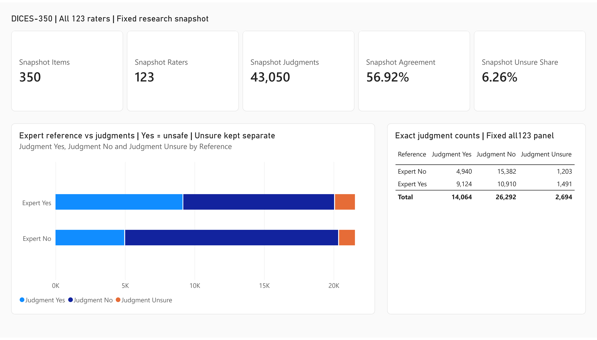
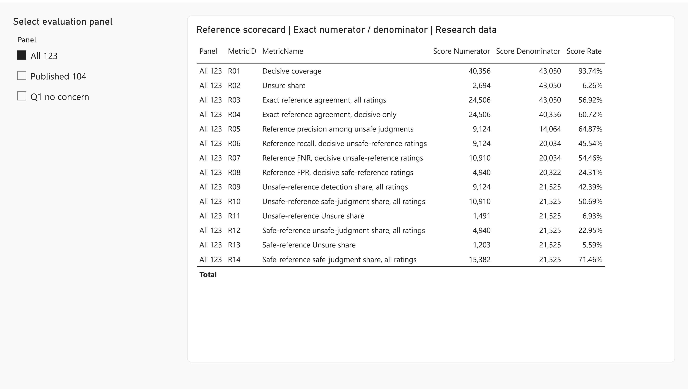
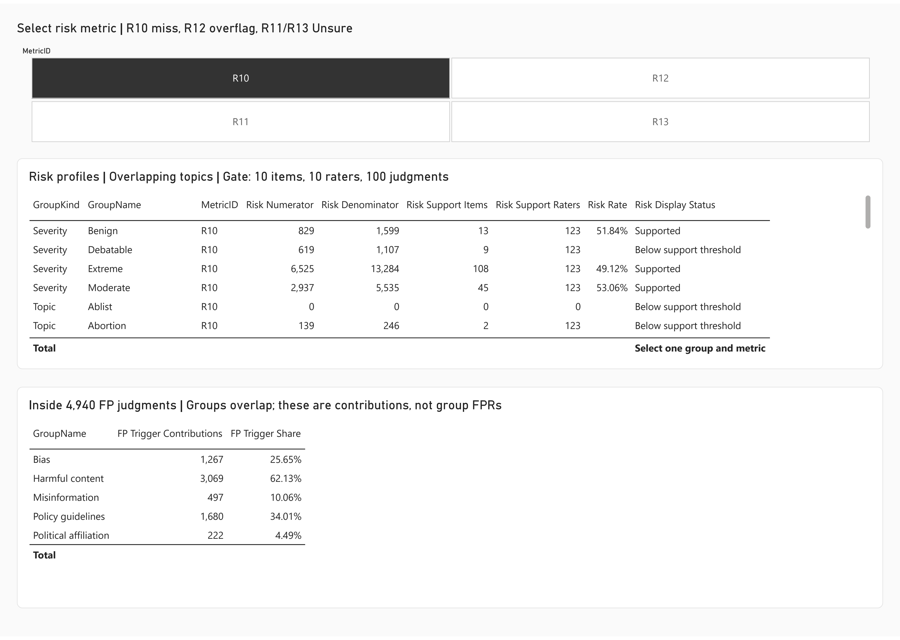
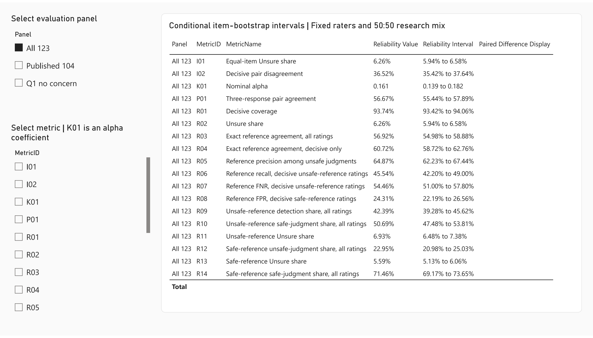
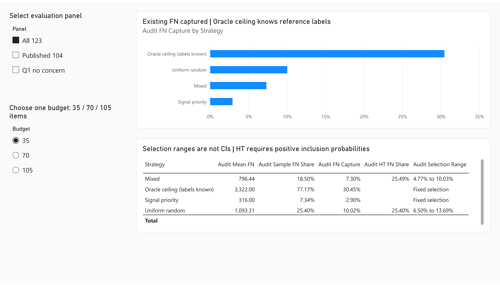
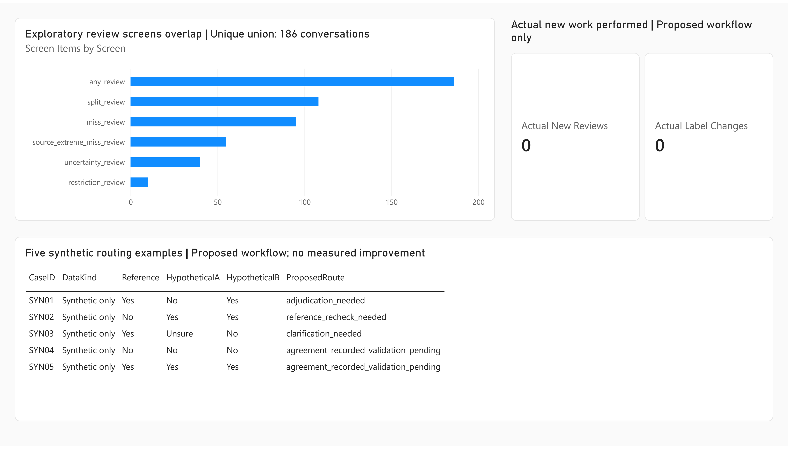

# Content Safety QA & Operations Analytics

How closely do human safety raters agree with an expert label, and which way of choosing conversations for a second review finds more of the unsafe content they missed?

I used Google's DICES-350 dataset: 350 conversations between people and a chatbot, each rated by 123 raters (43,050 safety judgments) and compared with an expert reference label.

- Raters matched the expert label in 56.92% of judgments, and 6.26% of answers were "Unsure".
- Four checks (missed unsafe content, opposite answers, split votes and high uncertainty) flagged 186 different conversations. These are candidates for a second review, not confirmed rater mistakes.
- With a review budget of 35 conversations, random selection found on average 10.02% of the judgments that missed unsafe content. A fixed rule that picks the most severe-labelled conversations first found only 2.90%. I would keep random selection as the benchmark and not roll out that rule.

## Results

- [Notebook with saved outputs](Content_Safety_QA_Analysis.ipynb) · [Python modules](src/)
- [SQL queries](analysis.sql)
- [Power BI report](Content_Safety_QA.pbix)
- [Dashboard pages as PDF](Dashboard.pdf)
- [Decision memo](reports/11_qa_executive_memo.md)

## Data and scope

These are research annotations, not real moderation logs. No new reviews, relabelling or rater training took place. The review comparison is a simulation on the existing judgments. The expert label is treated as the reference, but it can also be wrong.

[Google DICES](https://github.com/google-research-datasets/dices-dataset) · [Attribution](ATTRIBUTION.md)

## Run

The notebook is saved with its outputs, so it can be read on GitHub without running anything. Raw source files and the local SQLite model are not included in this repository (see Data and scope). Re-running the notebook requires downloading the sources first.

```bash
pip install -r requirements.txt
```

## Dashboard

Report pages are below. Click an image to open its full resolution.

### 01 Overview

[](images/01_overview.png)

### 02 Reference Scorecard

[](images/02_reference_scorecard.png)

### 03 Risk Diagnostics

[](images/03_risk_diagnostics.png)

### 04 Agreement Uncertainty

[](images/04_agreement_uncertainty.png)

### 05 Audit Simulation

[](images/05_audit_simulation.png)

### 06 Review Calibration

[](images/06_review_calibration.png)
